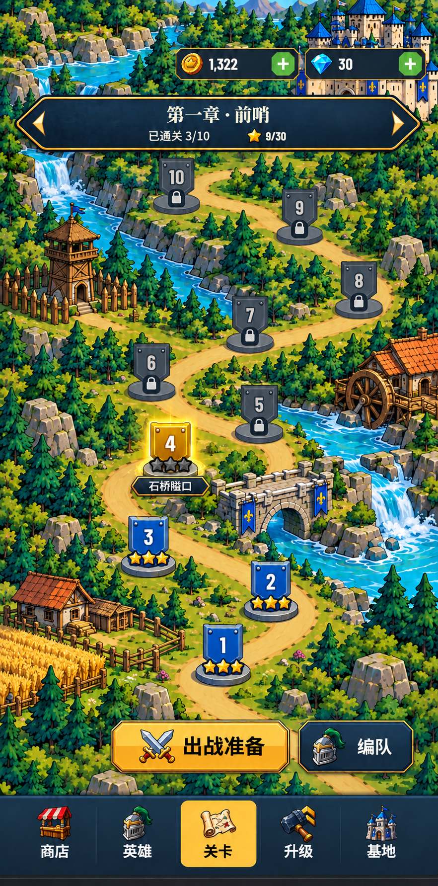
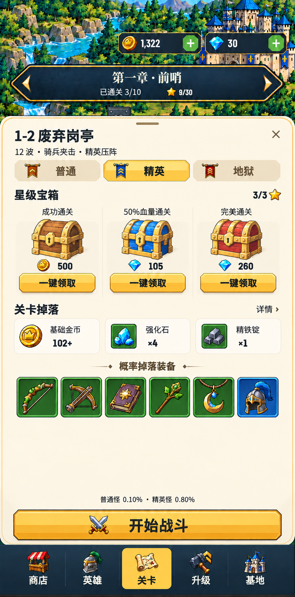
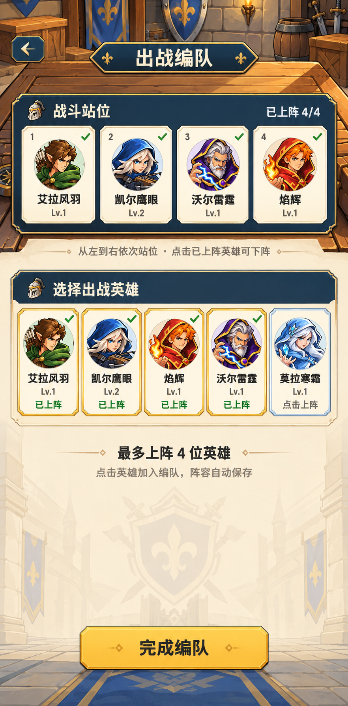

# 关卡页美术效果稿 v7

本次仅制作界面效果稿，未修改运行代码、资源、存档或线上版本。使用内置 image_gen，原始提示词及输入参考记录在 [prompts.json](prompts.json)，局部修订提示词见 [refinements.json](refinements.json)。三张交付原图的尺寸和SHA256见 [artifacts.json](artifacts.json)。

三张独立竖屏效果稿：

- `campaign-map.png`：路线地图主页面。连续地图、资源胶囊、收尖深蓝章节牌、不同关卡状态和石质底座。9/10关位于章节牌下方；出战准备居中、编队在右，悬浮操作区不加通栏背板，底部导航维持原选中样式。
- `battle-preparation.png`：精英难度出战准备抽屉。加粗标题、三枚难度旗、三色宝箱和一键领取、金币与材料图标、完整方形品质槽、两行高的装备区域。材料数量带×，不加通关必得或出战阵容。全部内容直接展示；地图位置和抽屉长度保持设计约束。
- `squad-formation.png`：出战编队全屏界面。保留四站位、五英雄选择和完成编队；优化海军蓝站位板、浅白英雄卡、选中细边和房间/浅纸背景衔接，减少大片单色空白。

图稿中的可领取宝箱是状态示例，不代表修改用户领取记录。精英1-2的波数、材料、宝箱金额参考当前配置：12波、强化石×4、精铁锭×1、500金币/105钻石/260钻石。角色身份和图标样式参考用户提供截图。

保留完整生成原图，不裁切、拼接或用程序重绘。图内文字与细节属于美术概念预览，后续落地仍使用原生标签和真实游戏数据。

