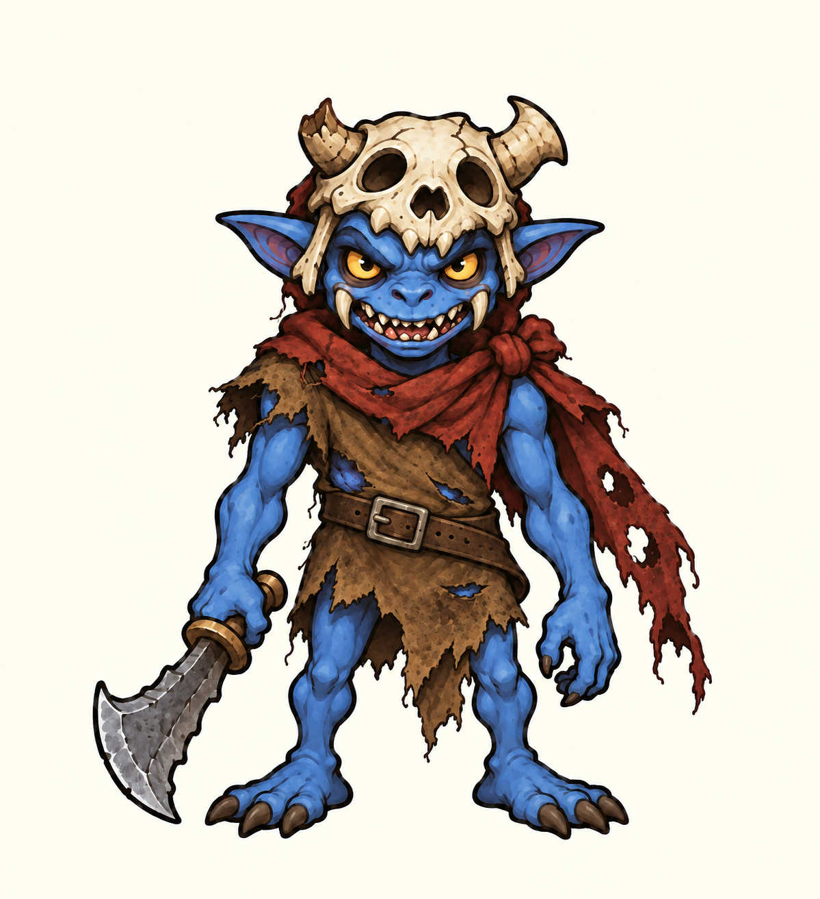
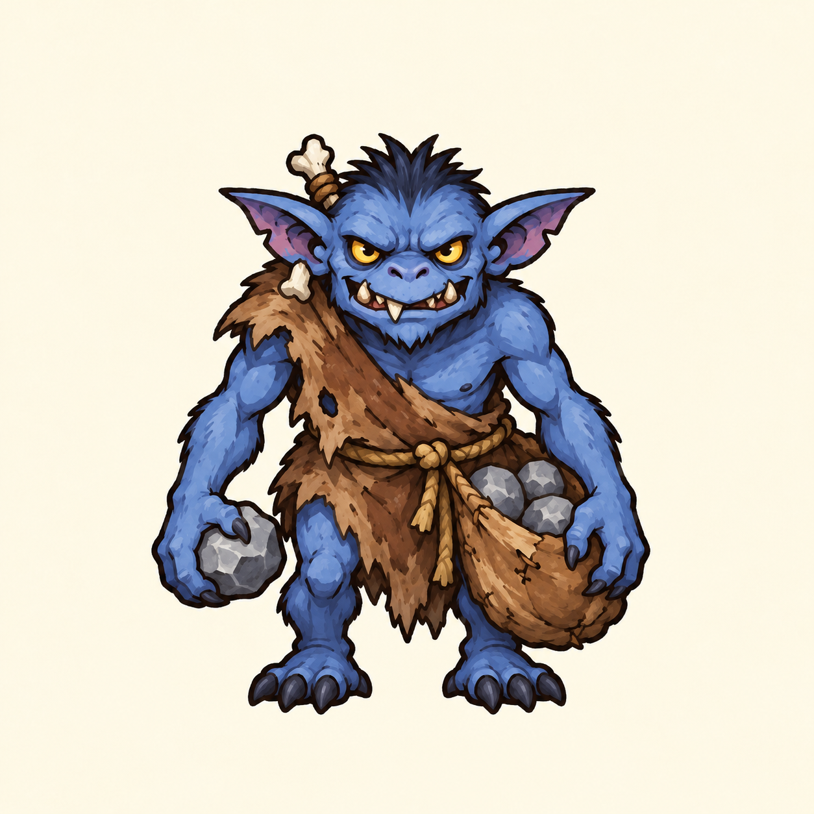
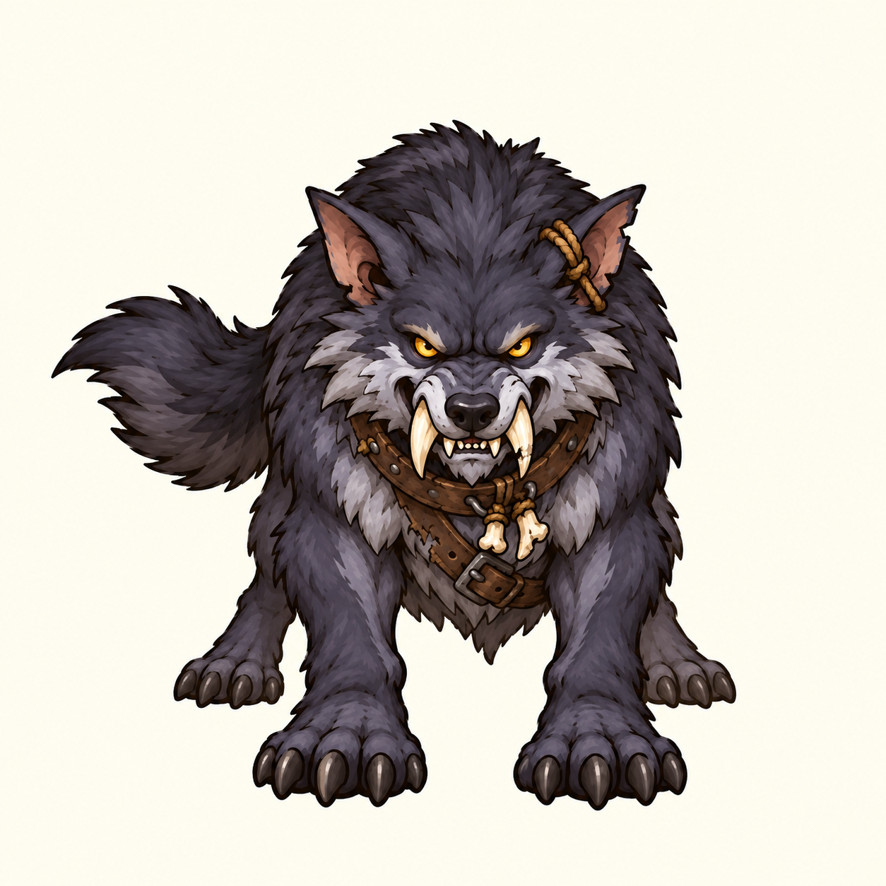
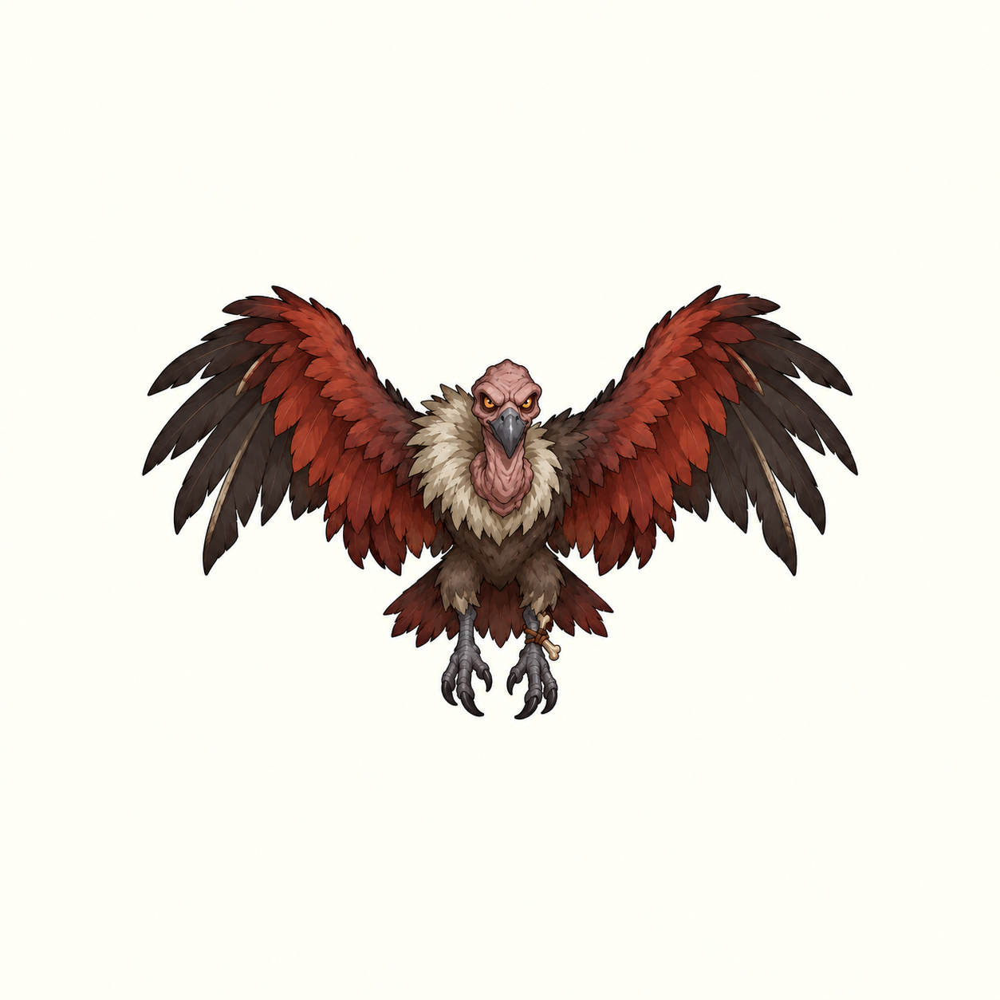
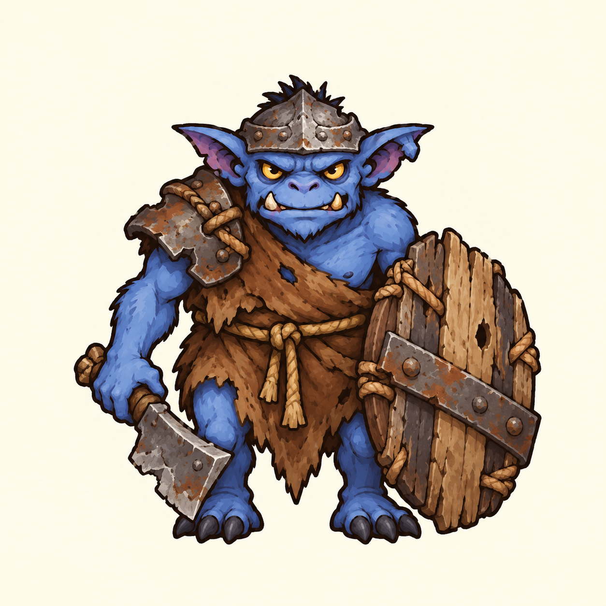
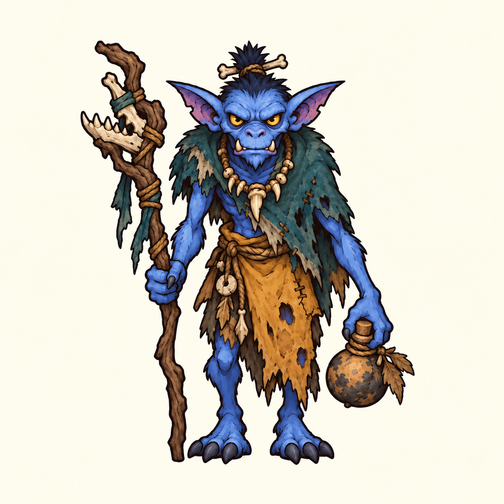
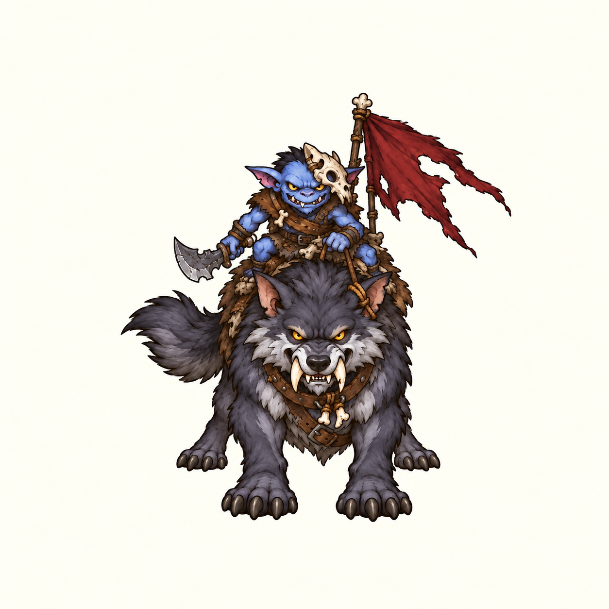
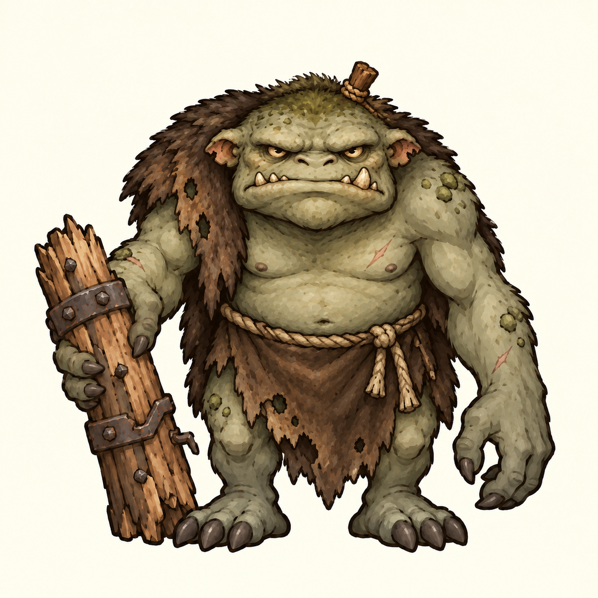
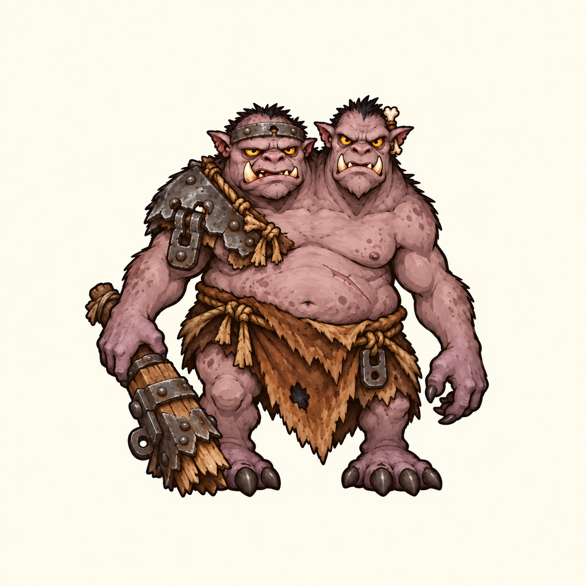

# 第一章怪物设计 · 九张审阅包

> **2026-10-21 状态更新：用户已明确「全部废案」。本包全部候选已否定，仅保留历史，不作为美术定稿、后续母型或新生成参考。下文记录是被否定前的交付记录。**

已补齐本轮剩余 **5 只**，加上当前已有 **4 只候选**，共 **8 种常规怪物 + 1 个关底 Boss**。全部等待用户逐张评价，没有把“继续”记作美术已认可。

[打开九宫格与逐张审阅页](index.html) · [来源、提示词及文件散列](manifest.json)

审阅页可点击放大，用左右方向键切换，并为每只写备注、导出全部备注。备注尽量保存在当前浏览器；若浏览器禁止本地存储，请及时导出。审阅包解压后打开 `index.html`，保持 `assets` 和 `prompts` 目录相对位置即可，不需要网络或启动游戏。

## 总览

| 01 兽族散兵 | 02 兽族投手 | 03 噬骨座狼 |
| --- | --- | --- |
|  |  |  |

| 04 赤翼秃鹫 | 05 兽人盾兵 | 06 骨杖巫医 |
| --- | --- | --- |
|  |  |  |

| 07 赤旗狼骑 | 08 碎木巨魔 | 09 双头食人魔「断门者」 |
| --- | --- | --- |
|  |  |  |

图片按各自原画等比显示，**不代表游戏内体型比例**。所有单张均为内置 image_gen 输出 PNG 的原字节复制，没有为总览重新生成角色或裁切原图。

## 逐张清单

### 01 兽族散兵

- 定位：基础近战；已有候选，待审阅。
- [单张原图](assets/01-grunt.png)
- 提示词：[第 1 轮](prompts/01-grunt.txt)

保留当前 v12 候选：骨盔、破红布和低位短刃。原图与历史记录均保留，不因继续制作视为认可。

### 02 兽族投手

- 定位：远程投石；已有候选，待审阅。
- [单张原图](assets/02-stone-thrower.png)
- 提示词：[第 1 轮](prompts/02-stone-thrower-design.txt) · [第 2 轮](prompts/02-stone-thrower-front-fix.txt)

保留当前 v14 正面修正候选，采用兽吻、短曲腿、侧挂兽皮和石囊，石块低握在腿侧。

### 03 噬骨座狼

- 定位：快速近战；已有候选，待审阅。
- [单张原图](assets/03-bone-warg.png)
- 提示词：[第 1 轮](prompts/03-bone-warg-camera.txt) · [第 2 轮](prompts/03-bone-warg-gentler-camera.txt)

保留当前 v2 正面微俯视候选，露出一点肩背。四足机位按用户最新要求记录。

### 04 赤翼秃鹫

- 定位：飞行；已有候选，待审阅。
- [单张原图](assets/04-redwing-vulture.png)
- 提示词：[第 1 轮](prompts/04-vulture-design.txt) · [第 2 轮](prompts/04-vulture-padding.txt)

保留当前 v1 留白修正候选。秃头钩喙、赤翼暗羽，双翼和爪尾完整。

### 05 兽人盾兵

- 定位：防御；本轮新增，待审阅。
- [单张原图](assets/05-shieldbearer.png)
- 提示词：[第 1 轮](prompts/05-shieldbearer.txt)

本轮新图。矮宽体型、铁小盔、旧皮肩甲、拼木盾和低位短刃，脸部仍有兽吻，盾牌没有遮脸。

### 06 骨杖巫医

- 定位：治疗支援；本轮新增，待审阅。
- [单张原图](assets/06-bone-healer.png)
- 提示词：[第 1 轮](prompts/06-bone-healer.txt) · [第 2 轮](prompts/06-bone-healer-front-fix.txt)

本轮新图。瘦长体态、骨杖药囊、偏肩青灰披料与赭色腰料。初稿轻微歪头，已定向修正头部朝向；草药与挂饰等细节仍由用户审阅。

### 07 赤旗狼骑

- 定位：骑乘冲锋；本轮新增，待审阅。
- [单张原图](assets/07-red-banner-wolfrider.png)
- 提示词：[第 1 轮](prompts/07-red-banner-wolfrider.txt) · [第 2 轮](prompts/07-red-banner-wolfrider-padding.txt)

本轮新图。沿用当前座狼，小型蓝皮骑手、局部骨盔和侧后破旗。正面微俯视；初稿旗尖过近边缘，已扩大整个单位的留白。

### 08 碎木巨魔

- 定位：重型精英；本轮新增，待审阅。
- [单张原图](assets/08-splinterwood-troll.png)
- 提示词：[第 1 轮](prompts/08-splinterwood-troll.txt) · [第 2 轮](prompts/08-splinterwood-troll-species-fix.txt)

本轮新图。苔灰绿长臂短腿、扁宽头颌和断木桩。初稿较像放大兽族兵，已再改为小耳低宽头型、背肩皮披和独立腰围，去掉重复的斜胸兽皮衣。

### 09 双头食人魔「断门者」

- 定位：关底 Boss；本轮新增，待审阅。
- [单张原图](assets/09-gatebreaker-boss.png)
- 提示词：[第 1 轮](prompts/09-gatebreaker-boss.txt) · [第 2 轮](prompts/09-gatebreaker-boss-padding.txt)

本轮新图。恰好两颗不同头型共用一个厚重躯干，两臂两腿；灰粉皮肤、锈铁门件肩甲、破门梁。两脸正面，最后扩大整体留白。

## 制作记录与范围

- 使用内置 image_gen：本轮五只分别生成，再针对巫医正面、狼骑留白、巨魔物种/衣装差异、Boss 留白做定向编辑。
- 蓝皮兽族按当前投手与原狼骑小骑手限定物种；巨魔和食人魔建立不同体型、头颌和配色。参考图各自用途与完整提示词已保存。
- 用户要求保持头脸正面。四足/狼骑使用微俯视、露一点背；不把微俯视理解为仰头或侧脸。纯色不透明浅背景，保留完整轮廓和留白。
- 图像已逐张静态观察；九张正式候选复制后 SHA256 一致、PNG 尺寸及所需文件路径已静态核对。提示词中的机位角度、留白百分比是制作目标，未作为精确三维测量结果，也没有验证未来动作范围。
- `drafts` 仅保存本轮被助手继续修订的初稿，不出现在审阅总览。旧四张原目录和历史版本保持。
- 当前是美术概念审阅包，尚未做透明动作母图、序列帧或替换游戏资源。未启动游戏/浏览器、未构建发布、未提交 Git。
