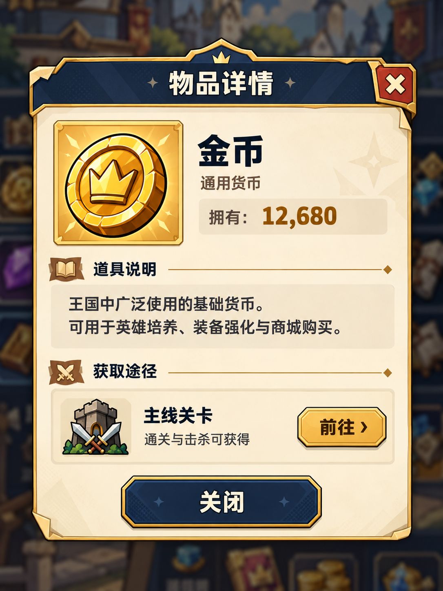

# 物品详情弹窗美术效果图 v1

2026-10-22，按用户要求先生成一张美术优化效果图。使用内置 image_gen，以用户两张弹窗截图为信息层级参考，并以游戏现有 `comic_coin_v1` 皇冠金币为物品参考。采用深蓝标题、暖色纸面、金色细框；展示金币、通用货币、示例拥有数量、道具说明、主线获取途径和关闭按钮。

当前仅为单张概念预览，尚未获用户美术确认，没有替换运行时弹窗、增加新入口或改动存档与经济规则。数量12,680、前往按钮及城堡背景均为效果图示例。图片由内置工具原样复制，SHA一致；完整提示词见 `prompt.txt`，来源与参考角色见 `manifest.json`。未启动浏览器、游戏或交互验收。
